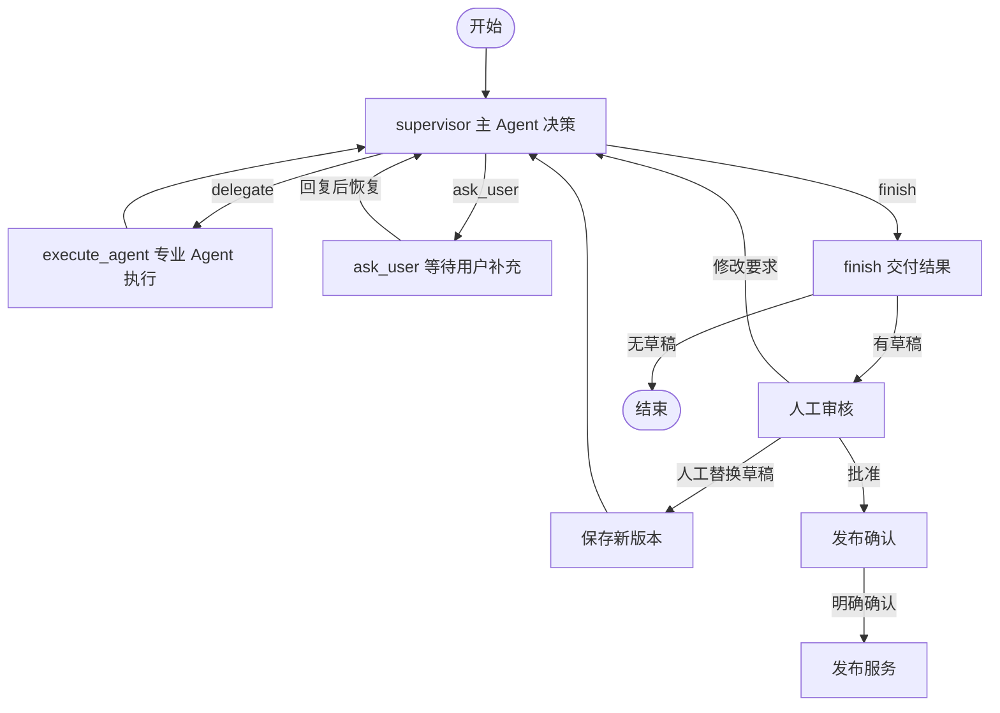

# 主 Agent 协作流程与协议

项目统一运行父 Agent 驱动的 LangGraph 图。父 Agent 调用真实模型决定委派、提问或结束；子 Agent 通过统一适配器执行。Web 对话、CLI 和后端 API 使用同一套协作与恢复协议。

## 第一阶段验收状态

协作协议已接入实际父子调用链，包含正常执行、缺少输入、执行失败、人工回复和重启恢复。

| 要求 | 实现文件 | 验收方式 |
| --- | --- | --- |
| 父 Agent 理解目标、拆分、委派、检查结果和决定下一步 | `agents/supervisor.py`、`graph.py` | 动态选择子 Agent；按完成条件检查结果；三类决策走条件边 |
| 统一委派与执行结果 | `models/collaboration.py`、`agents/base.py`、`agents/delegation.py` | 四类专业接口统一适配为 `run(task)`；校验任务、委派和执行者身份 |
| 可追溯的完成或失败 | `team_store.py`、`agents/runtime.py` | 不可变产物、失败结果缓存、安全的具体校验错误与公共事件 |
| Agent 和技能/工具白名单 | `agents/registry.py`、`skills/library.py` | 拒绝未登记角色、权限扩张、虚构引用及无新信息的重复失败委派 |
| 端到端验证 | `tests/test_collaboration.py`、`tests/test_collaboration_failures.py`、`tests/test_team_graph.py`、`tests/test_model_configuration_sources.py` | 离线覆盖协议、失败回传、恢复、模型参数实际生效与人工门禁 |

完成条件有两层：程序验证输出类型、非空必要内容、实际产物引用和草稿/审核版本；父 Agent 逐项对照 `acceptance_criteria` 判断内容是否满足委派目标。文本条件的语义判断由模型完成，并不等于逐条条件都有确定性的自动判定器。审核完成也不等于稿件通过或获准发布。

代码精简已合并 `graph.py` 中批准、取消和替换草稿的重复节点包装；前端移除了旧侧栏、预览卡和设置标签等 47 个未引用样式选择器。生产代码中没有旧固定选题/调研/创作路由的调用入口。`workflow.py` 负责当前检查点与人工操作校验，`team_store.py` 负责当前委派账本，发布子图负责人工确认后的提交，均是现用代码。旧数据的只读识别、序列化白名单和 SQLite 增量迁移仍服务已有任务数据，不能作为废弃工作流直接删除。

## 运行结构



`graph.py` 是唯一图入口，负责父 Agent 节点、条件边与人工确认；`agents/supervisor.py` 调用项目 LLM Provider 作决策，`agents/delegation.py` 适配子 Agent，`team_store.py` 维护委派账本和版本化产物。每轮由模型根据执行历史和当前产物决定下一步。

五个角色都有模型实现，可通过前端分别配置。调研、创作默认 Mock，审核默认规则；切换到模型后由 `agents/structured.py` 提供对应实现，并沿用 `SpecialistDelegate` 的存储与版本约束。配置检索服务后，调研模型可以自主搜索并提取正文，来源和摘录须通过工具会话校验；创作可接入独立图片生成/编辑接口与视觉输入。模型审核始终合并本地规则结果。配置及能力边界见 [专业 Agent 执行能力](specialist-execution.md)。自定义执行器也可以通过 `TaskService(delegated_agents={"creation": worker})` 注入，须持久化产物并遵守对应业务落库约束。

## 启动与模型配置

```powershell
# 文件分别包含 supervisor 与 ideation 配置
uv run xhs --llm-config examples/llm-config.json create "周末出游" --material "周六走过江边步道"

# 完全离线需要分别指定父 Agent 和选题的 Mock 模式
uv run xhs --mock-ideation --mock-supervisor create "周末出游" --no-research

# 查看主 Agent 当前问题、真实暂停位置，以及协作记录
uv run xhs status TASK_ID
uv run xhs collaboration TASK_ID
uv run xhs answer TASK_ID --text "实际走过江边步道，想分享交通方式"

# 草稿人工审核、修改、批准与发布命令保持原用法
uv run xhs modify TASK_ID --comment "补充交通方式"
uv run xhs approve TASK_ID
```

父 Agent 必须使用独立的 `supervisor` 配置，结构与 `ideation` 相同，分别设置 provider、model、base_url、api_key 或 api_key_env。缺少父 Agent 配置会明确失败。两个角色可以显式选择同一厂商或模型，但不会隐式继承另一角色的配置与凭据。API Key 不进入图状态、协作记录或事件。

```json
{
  "supervisor": {
    "provider": "deepseek",
    "model": "填写父 Agent 的实际模型 ID",
    "api_key_env": "XHS_SUPERVISOR_API_KEY"
  },
  "ideation": {
    "provider": "deepseek",
    "model": "填写选题 Agent 的实际模型 ID",
    "api_key_env": "DEEPSEEK_API_KEY"
  }
}
```

不使用文件时，父 Agent 只读取 `XHS_SUPERVISOR_PROVIDER/MODEL/API_KEY/BASE_URL/PROTOCOL` 等独立环境变量，选题继续读取 `XHS_LLM_*`。父 Agent 的配置没有显式密钥或密钥变量时，只查找 `XHS_SUPERVISOR_API_KEY`。需要使用其他密钥变量时，在 supervisor 中明确设置 `api_key_env`。

Python 配置为 `AgentConfig(supervisor_llm=..., ideation_llm=..., team_max_rounds=20)`。两个角色的 backend 分别默认 `llm`，`supervisor_backend` 与 `ideation_backend` 可单独设置。CLI 的 `--mock-supervisor` 仅模拟父 Agent，`--mock-ideation` 仅模拟选题；支持与配置文件组合，例如模拟选题并从文件加载真实 supervisor。`MockSupervisorAgent` 只用于显式离线演示，模型失败不会回退到 Mock。

Web 提供 `GET /api/settings` 查询五个角色的公开配置，以及 `GET/PUT /api/settings/{role}` 单独读写；role 为 supervisor、ideation、research、creation、review。`POST /api/settings/{role}/copy` 接收 `{"source_role":"supervisor"}`，显式复制来源模型、接口和凭据。密钥按角色、服务商和接口地址分别加密，直接密钥不会出现在任何响应中。环境变量模式复制变量引用。

公开配置包含 `config_source` 和 `startup` 基线摘要，`max_tokens`、`timeout` 会传入实际模型。`DELETE /api/settings/{role}` 只撤销该角色网页覆盖，恢复跟随启动配置；不会改写 JSON 或改变其他角色。详见 [模型配置来源说明](model-configuration.md)。

角色下拉框只列出其他 Agent 已保存且凭据已配置的真实模型。复制立即保存，之后每个角色继续独立管理。可选文件配置也支持 research、creation、review 对象；CLI 发现这些对象后启用对应模型实现。各角色默认行为不因其他角色保存模型而自动改变。

## 后端交互 API

- `GET /api/tasks/{id}/workflow`：返回 `ask_user` 的问题、缺失信息、`interrupt_id` 和允许操作。
- `GET /api/tasks/{id}/collaboration`：返回当前决策、委派历史、公开对话消息、产物目录、用户补充和交付摘要；任务详情也包含该快照。
- `POST /api/tasks/{id}/answer`：接收 `request_id`、`expected_version`、`interrupt_id`、`answer`，返回后台作业。
- `POST /api/tasks/{id}/message`：待审核或待发布时接收 `text` 及相同的幂等/版本/暂停标识，重新交给父 Agent；已有批准随之撤销，需要再次人工确认。
- `GET /api/tasks/{id}/artifacts?artifact_id=...&version=...`：只读取属于当前任务的不可变产物，不能跨任务或读取任意文件。
- 现有取消、修改、替换草稿、批准、发布等 API 继续使用版本与精确中断 ID 校验。

示例请求体：

```json
{
  "request_id": "9ff10ccf-12aa-49f0-a993-c1ed39972f35",
  "expected_version": 0,
  "interrupt_id": "从当前 workflow 接口取得实际 ID",
  "answer": "我走过江边步道，想给上班族推荐周末路线"
}
```

前端以父 Agent 对话为中心，旁边展示真实分工、执行状态及可展开的版本化产物。公开对话写入图状态的 `conversation`，包含需求回应、委派说明、问题、用户回复及交付摘要，不包含模型原始消息与内部推理。旧选题恢复接口和流程切换参数已移除。

## 持久化与恢复

`workflow_version=2` 标识当前父子 Agent 图。该字段用于校验检查点格式，不再用于选择两套执行引擎。旧图任务数据保留，但图状态返回 `unsupported`，不能继续恢复或提交发布；请新建任务。已批准的历史文案仍可导出，已有提交回执仍可人工核实。

主 Agent 每轮的合法决策先写入业务库；模型节点重放时复用同轮决策。委派执行前记录任务内容与起始草稿版本，完成后写入匹配的结果。重放时复用已完成的委派和产物；草稿提交后异常也可按原起始版本复用已保存版本。

内置子 Agent 的模型输出错误、长度限制、连接/超时或 HTTP 错误转为 `failed`，携带安全的 `failure_reason` 回到父 Agent；输入不足返回 `needs_input`。父 Agent 可以调整要求后重新委派，也可以提问暂停。未改变要求/输入/完成条件且没有新用户回复时，不能原样重复上一条失败委派；协作总轮次仍受预算限制。离线父 Agent 在失败后直接提问，每次回复最多重试一次，持续失败时再次等待用户。

模型配置错误、存储错误和未分类的程序异常保留为失败图节点，修复后使用 `retry` 恢复原节点。发布异常仍走独立的回执与防重复提交规则，不转给父 Agent 自动重发。

已返回的失败结果和成功结果一样不可覆盖。用户修复模型配置后，在父 Agent 的问题下回复，后续执行会创建新 `delegation_id`；原失败记录保留。同一 ID 的检查点重放只取缓存结果。`DelegationRecord.user_message_count` 记录执行时已收到的用户消息数，用于区分失败前的信息与后续回复；旧记录缺省为 0。

输出校验失败时，Runtime 发出 `output_validation` 事件，包含角色、校验次数、是否继续修正，以及字段路径/错误类型或业务规则。达到修正次数或模型调用预算后，最终异常保留最后一条校验说明。事件由 Web 作业持久化，不包含原始响应、无效字段值或内部推理。

每次用户回复或人工修改后重新计算协作预算，默认最多 20 轮父 Agent 决策；超限会明确失败。检查执行记录后可提高 `team_max_rounds` 并重试。返工由父 Agent 决定，并受协作预算限制。

产物不可覆盖同一版本，决策只能引用当前目录中确实存在的产物。同一次委派的每类输入只允许一个引用，避免适配器覆盖同类数据；多个文本素材可放入 `materials` 或一个 `material` 数组。目录提供各类最新产物，历史保留先前的委派与结果。交付已有草稿前必须审核当前版本，审核正文的 `draft_version` 也必须匹配；用户提出修改后必须有新版本。主 Agent 的 `finish` 不会批准或发布草稿，交付草稿会进入独立人工审核节点。

## 主 Agent 的职责

1. 理解用户目标、画像、素材和约束，识别缺失信息。
2. 根据现有产物拆分任务，选择已注册且允许委派的专业 Agent。
3. 提供明确的任务要求、输入资料和完成条件。
4. 检查执行状态、摘要和产物，再决定委派、提问或结束。

`agents/supervisor.py` 提供模型实现、职责常量、提示词和决策 schema/解析器。`agents/base.py` 提供两个 Protocol：

```python
class SupervisorAgent(Protocol):
    def decide(self, context: SupervisorContext) -> SupervisorDecision: ...

class DelegatedAgent(Protocol):
    def run(self, task: DelegationTask) -> DelegationResult: ...
```

现有 `ideate/research/create/review` 接口由 `SpecialistDelegate.run()` 适配，原专业实现继续工作。委派的 instruction、materials 和 acceptance_criteria 会传入专业实现；修改还会携带上一版草稿。引用候选选题时，使用 `DelegationTask.idea_index` 明确选择候选。

## 统一的数据模型

模型位于 `src/xhs_agent/models/collaboration.py`，也可以从 `xhs_agent.models` 导入。共享角色类型位于 `models/base.py`。协议拒绝额外字段，字符串不能空白；协议集合使用 tuple，并以 JSON 数组传输。

| 模型 | 主要字段与含义 |
| --- | --- |
| `ArtifactReference` | `task_id`、`artifact_id`、`kind`、正整数 `version`、`summary`；只引用产物，不携带专业 Agent 的完整对话 |
| `DelegationTask` | `task_id`、`delegation_id`、`target_agent`、`instruction`、`input_artifacts`、`materials`、`acceptance_criteria` |
| `DelegationResult` | 业务任务与委派 ID、`agent_id`、`status`、`summary`、`artifacts`、`missing_information`、`failure_reason` |
| `DelegationRecord` | 一对匹配的 `task` 和 `result`，以及执行时的 `user_message_count` |
| `SupervisorContext` | 需求、画像、当前可用 Agent 目录、产物目录、执行历史和用户补充信息 |
| `AgentDefinition` | 角色、描述、职责、技能 ID、工具名称、启用状态和是否可委派 |

`task_id` 是整个内容任务的 ID，`delegation_id` 是其中一次委派的 ID。没有指定委派 ID 时生成 UUID；新的委派使用新 ID，执行重试复用原委派对象及 ID。执行层使用委派账本检查 ID 与输入一致性。

产物类型支持 `material/trends/ideas/idea/brief/draft/review`。引用是逻辑标识，不能用于直接读取任意文件。`TeamStore.resolve()` 根据业务任务与版本检查引用，并加载完整输入；主 Agent 的目录只包含摘要和引用。

一次委派示例：

```json
{
  "task_id": "task-1",
  "delegation_id": "delegation-1",
  "target_agent": "review",
  "instruction": "检查草稿是否满足用户要求，指出证据不足的段落",
  "input_artifacts": [{
    "task_id": "task-1",
    "artifact_id": "draft-1",
    "kind": "draft",
    "version": 1,
    "summary": "基于用户出游素材创作的第一版草稿"
  }],
  "materials": ["用户要求：保留实际路线，不添加没有去过的景点"],
  "acceptance_criteria": ["列出具体问题与修改建议", "标记缺少来源的事实"]
}
```

执行结果有三个状态：

- `completed`：完成当前委派，返回摘要与可选产物；不能同时声明缺失信息或失败原因。完成某次审核委派不代表稿件已经通过审核，更不代表用户批准发布。
- `needs_input`：无法继续，需要填写非空 `missing_information`。
- `failed`：执行失败，需要填写非空 `failure_reason`。

`needs_input/failed` 也允许返回已有的部分产物，主 Agent 根据结果决定下一步。`DelegationRecord` 和 `registry.validate_result(task, result)` 会检查任务、委派 ID 和 Agent 是否匹配。

## 主 Agent 的三类决策

`SupervisorDecision` 是以 `action` 为判别字段的联合类型：

| action | 必要内容 |
| --- | --- |
| `delegate` | `reason`、完整的 `task: DelegationTask` |
| `ask_user` | `reason`、`question`、非空 `missing_information` |
| `finish` | `reason`、`summary`，可选的 `artifacts` |

解析 JSON 时使用 `SUPERVISOR_DECISION_ADAPTER`，需要执行目录与上下文检查时使用 `registry.validate_decision()`。后者会额外检查目标角色是否可委派、是否出现在当前目录中、业务任务是否匹配、委派 ID 是否重复，以及引用是否来自当前产物目录。

```python
from xhs_agent.agents import build_agent_registry
from xhs_agent.models import ContentRequest, SupervisorContext, UserProfile
from xhs_agent.skills import SkillLibrary

registry = build_agent_registry(SkillLibrary())
context = SupervisorContext(
    task_id="task-1",
    request=ContentRequest(goal="整理一篇周末出游笔记"),
    profile=UserProfile(),
    available_agents=registry.catalog(),
)
decision = registry.validate_decision({
    "action": "delegate",
    "reason": "先整理选题方向",
    "task": {
        "task_id": "task-1",
        "target_agent": "ideation",
        "instruction": "围绕周末出游提出三个可执行的选题",
        "acceptance_criteria": ["结合用户画像", "列明还需要的真实素材"],
    },
}, context)
assert decision.task.target_agent == "ideation"
```

schema 校验不能判断目标是否真正完成、事实是否真实，主 Agent 需要对照完成条件检查内容，业务服务继续验证版本和人工批准。`finish` 表示结束本轮协作，不写入发布状态，也不代替人工批准。

## 注册表与权限

`agents/registry.py` 的 `AgentRegistry` 只能由可信应用代码组装；模型无法修改注册表，也不能通过输出模块路径加载 Python 对象。

默认定义六个角色：

| 角色 | 可委派 | 技能与工具 |
| --- | --- | --- |
| `supervisor` | 否 | 默认无技能读取工具；绑定真实模型主 Agent 或显式离线演示协调器 |
| `ideation` | 是 | 技能库中的选题授权；两个技能读取工具 |
| `research` | 是 | 调研技能；技能工具、配置后的 web_search/web_fetch |
| `creation` | 是 | 创作技能；技能工具、配置后的 generate_image/inspect_image |
| `review` | 是 | 审核技能；技能工具、run_rules、配置后的 inspect_image |
| `publishing` | 否 | 发布服务；默认无技能读取工具 |

`catalog()` 默认只返回启用且可委派的角色，`catalog(delegatable_only=False)` 包含其他启用角色。`agent(id)` 只返回应用实际注入的实例，尚未绑定实现时会报错。仅有定义并不意味着模型与工具执行能力已接入。

`AgentDefinition.skill_ids` 与 `skills/registry.json` 的角色授权取交集。注册时禁止扩大角色授权；每次读取继续检查技能是否被撤销或禁用。注册表可进一步缩小单个角色范围，不能通过技能正文获得新权限。默认注册表取构建时的技能授权快照，增加授权后需要重建服务/注册表。

`tool_names` 只允许当前角色已实现的工具，并由实际服务配置进一步缩小。例如只授权 `load_skill`，Runtime 就不会向模型提供资源读取工具；模型即使自行生成资源读取调用，也会收到工具错误。调研工具不能授权给创作，图片生成不能授权给审核。技能的 `required_tools` 不会自动变成实际工具。

```python
from xhs_agent.agents import AgentRegistry
from xhs_agent.models import AgentDefinition

restricted_registry = AgentRegistry(SkillLibrary())
restricted_registry.register(AgentDefinition(
    agent_id="ideation",
    description="只使用选题评估技能的选题 Agent",
    responsibilities=("评估选题与画像的匹配程度",),
    skill_ids=("skill-topic-evaluator",),
    tool_names=("load_skill",),
    delegatable=True,
))
```

`TaskService.agent_registry` 在团队模式登记专业 Agent 的统一执行适配器、主 Agent 和发布服务，并绑定对应技能和工具范围。自定义 Agent 若自行实现外部工具调用，需要遵守同样的权限契约；注册表不提供 Python 沙箱。

发布继续经过服务层的人工确认、账号核验、版本与指纹校验及防重复提交机制。主 Agent 决策不包含直接发布操作。
